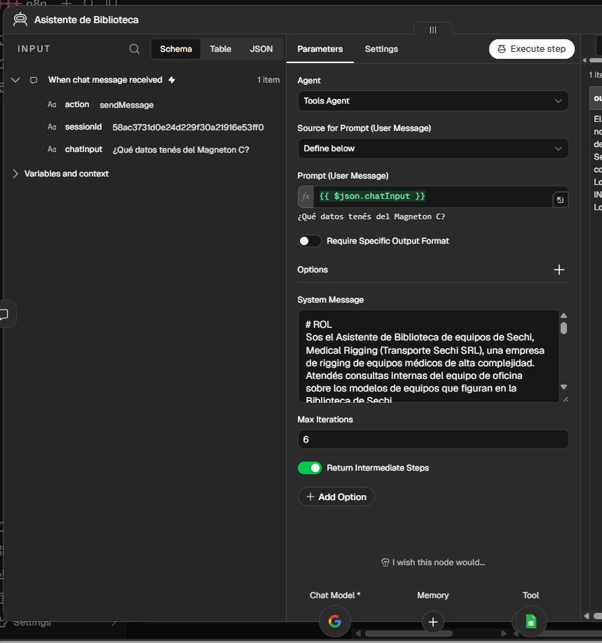

# Checkpoint 1 - Agente autónomo básico: Asistente de Biblioteca de equipos

Proyecto integrador de "AI Automation Avanzado" (Coderhouse) sobre un proceso real de **Sechi, Medical Rigging** (Transporte Sechi SRL): rigging de equipos médicos de alta complejidad.

Archivo del flujo: `checkpoint1_emiliano_coronel-pomice.json` (n8n).

## Qué hace
Un agente que atiende consultas internas sobre modelos de equipos médicos (por ejemplo: "¿cuántos bultos tiene el Voyager y cuánto pesa el bulto más pesado?"). Consulta una planilla de Google Sheets (la Biblioteca, en modo solo lectura) y arma una ficha con los datos. Si el modelo no está o el registro está incompleto, **no inventa**: indica "Corresponde consultar con Logística". Al terminar, avisa por Slack con un mensaje "Tarea completada".

## Arquitectura
`When chat message received` -> `Asistente de Biblioteca (AI Agent, Tools Agent)` -> `Slack - Tarea completada`

Conectados al agente como extensiones laterales:
- **Google Gemini Chat Model** (modelo de lenguaje).
- **consultar_biblioteca_modelos** (Google Sheets Tool, lectura filtrada por modelo, con descripción semántica extensa).

## Cómo cubre la consigna
| Requisito | Dónde está |
|---|---|
| Trigger | Nodo "When chat message received" (Chat Trigger) |
| AI Agent en modo Tools Agent | Nodo "Asistente de Biblioteca" en modo Tools Agent (n8n no escribe en el JSON el valor por defecto; ver la captura `agente-tools-agent.png`) |
| Iteraciones máximas entre 5 y 10 | Opciones del agente: `maxIterations = 6` |
| System Prompt modular | Rol, Ámbito, Objetivo, Reglas y Escalamiento; con límites explícitos y sin lenguaje inclusivo |
| Herramienta acoplada de forma lateral | "consultar_biblioteca_modelos", conectada por la entrada de Tools del agente (nunca en secuencia) |
| Descripción semántica extensa | Campo "Description" de la herramienta |
| Observabilidad | Nodo "Slack - Tarea completada" (canal `biblioteca-sechi`): consulta, herramientas usadas, pasos ejecutados, respuesta y línea de estado (DATOS BASE COMPLETOS, INCOMPLETO o FUERA DE ALCANCE) |

## Captura de la configuración

## Decisión sobre el modelo
La consigna recomienda OpenAI o Anthropic. Este proyecto usa **Google Gemini** (`gemini-flash-lite-latest`) porque tiene tier gratuito continuo, algo necesario para un proyecto de varias semanas sin costo. Cambiarlo implica reemplazar un único nodo (Chat Model) sin tocar el resto del flujo.

## Para importar y probar
1. En n8n: Workflows > Import from file > elegir el `.json`.
2. Subir la planilla de prueba de la Biblioteca a Google Sheets y pegar su ID en la herramienta (hoja `Biblioteca_modelos`).
3. Elegir las credenciales de Gemini, Google Sheets y Slack, y el canal de Slack.
4. Abrir el chat y probar:
   - "¿Cuántos bultos tiene el Voyager y cuánto pesa el bulto más pesado?" (datos completos)
   - "Pasame la ficha del Pristina" (registro incompleto: deriva a Logística)
   - "¿Qué datos tenés del Magneton C?" (no figura en la planilla de prueba: deriva a Logística)
   - "¿Cuánto cobramos por llevar un Voyager a La Pampa?" (fuera de alcance: deriva a Logística)

## Seguridad
El archivo no contiene claves ni tokens. Las credenciales se vinculan en cada instancia de n8n. La herramienta es de solo lectura (mínimo privilegio).
